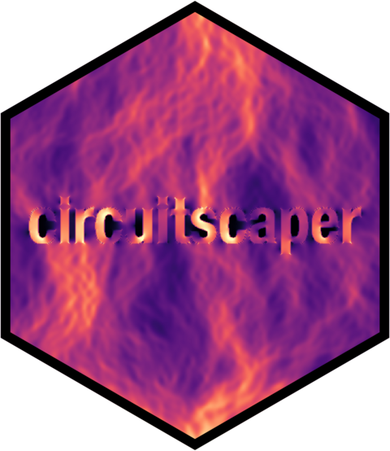

<!-- README.md is generated from README.Rmd. Please edit that file -->

```{r, include = FALSE}
knitr::opts_chunk$set(
  collapse = TRUE,
  comment = "#>",
  fig.path = "man/figures/README-",
  out.width = "100%"
)
```

# circuitscaper <a href="https://matthewkling.github.io/circuitscaper/"></a>

<!-- badges: start -->
[](https://github.com/matthewkling/circuitscaper/actions/workflows/R-CMD-check.yaml)
<!-- badges: end -->

**circuitscaper** is circuit-theory landscape connectivity for R. You work with `terra` rasters in R, while Julia handles the heavy lifting under the hood. It offers two families of methods:

* **Circuitscape and Omniscape** (`cs_*()`, `os_*()`): the established tools, run through [Circuitscape.jl](https://github.com/Circuitscape/Circuitscape.jl) and [Omniscape.jl](https://github.com/Circuitscape/Omniscape.jl), with the same results as running them directly.
* **Dipole methods** (`dp_*()`, experimental): circuitscaper's own methods for pairwise and omnidirectional connectivity, and for connectivity between two distributions. They factor one circuit and solve many superposed source–sink pairs against it, so a map takes about 32 solves whatever the number of pairs, and each map comes with an estimate of its own noise. They compute a related but different quantity (squared rather than absolute current) and are not yet published; see the [Dipole methods](https://matthewkling.github.io/circuitscaper/articles/dipole-methods.html) article.

Installation of Julia and its packages takes one line, and Julia threads speed up Omniscape and the dipole methods on large landscapes.

> Note: **circuitscaper** is an independent R package and is not affiliated with the Circuitscape development team. Its `cs_*()` and `os_*()` functions wrap the excellent Julia tools developed by Brad McRae, Viral Shah, Tanmay Mohapatra, Ranjan Anantharaman, and collaborators.


## Installation

``` r
# 1. Install the R package from CRAN
install.packages("circuitscaper")
# or install the development version from GitHub
# remotes::install_github("matthewkling/circuitscaper")

# 2. Let the package install Julia and the necessary Julia libraries
library(circuitscaper)
cs_install_julia()

# (Or, for the dipole methods alone, just Julia)
# cs_install_julia(circuitscape = FALSE)
```


## Example

```{r example, warning=FALSE, message=FALSE}
library(circuitscaper)
library(terra)

# Load an example resistance raster
resistance <- rast(system.file("extdata/resistance.tif", package = "circuitscaper"))

# Pairwise Circuitscape
# (result is a list containing the pairwise resistance matrix and current maps)
focal_sites <- matrix(c(10, 40, 40, 40, 25, 10), ncol = 2, byrow = TRUE)
result <- cs_pairwise(resistance, focal_sites)
plot(result$current_map)

# Omnidirectional connectivity across the whole landscape, with Omniscape's
# moving window and with random dipoles
# (each result is a multi-layer raster of current flow variables)
os <- os_run(resistance, radius = 10)
dp <- dp_omni(resistance, radius = 10, seed = 1)
plot(c(os$normalized_current, dp$normalized_current),
     main = c("os_run()", "dp_omni()"))
```


## Functions

Choose by the question you're asking; where both families answer it, the [getting started vignette](https://matthewkling.github.io/circuitscaper/articles/getting-started.html) helps choose between them.

| Question | Circuitscape and Omniscape | Dipole methods |
|---|---|---|
| How well connected are these sites, and through where? | `cs_pairwise()` | `dp_pairwise()` |
| How does current spread from, or converge on, each site? | `cs_one_to_all()`, `cs_all_to_one()` | |
| How does movement flow between a source area and a destination? | `cs_advanced()` | |
| Where are the corridors and barriers across the whole landscape? | `os_run()` | `dp_omni()` |
| How does movement link two distributions (such as seasonal ranges, or present and future habitat), and which way does it flow? | `os_run()` with `os_condition(future = )`, for climate | `dp_flux()`, `dp_omni(destination = )` |

Also:

| Function | Description |
|---|---|
| **`os_condition()`** | Define conditions for conditional Omniscape connectivity |
| **`dp_circuit()`** | Factor a circuit once, to reuse across dipole-method runs |
| **`cs_setup()`** | Initialize the Julia session and set its threads (called automatically) |
| **`cs_install_julia()`** | Install Julia and the required Julia packages |
| **`cs_julia_available()`** | Check whether Julia, Circuitscape.jl, and Omniscape.jl are installed |


## Requirements

- R >= 4.0
- Julia >= 1.10 (installed automatically via `cs_install_julia()`)
- R packages: terra, JuliaConnectoR


## Learn More

- [Getting started vignette](https://matthewkling.github.io/circuitscaper/articles/getting-started.html): installation, inputs and choosing a method
- [Circuitscape and Omniscape](https://matthewkling.github.io/circuitscaper/articles/circuitscape-omniscape.html): each mode and its options
- [Dipole methods](https://matthewkling.github.io/circuitscaper/articles/dipole-methods.html): using them, how they work, and how they compare
- [Circuitscape user guide](https://docs.circuitscape.org/Circuitscape.jl/latest/)
- [Omniscape documentation](https://docs.circuitscape.org/Omniscape.jl/latest/)
- McRae, B.H. (2006). Isolation by resistance. *Evolution*, 60(8), 1551-1561.
- McRae, B.H. & Beier, P. (2007). Circuit theory predicts gene flow in plant and animal populations. *PNAS*, 104(50), 19885-19890.
- McRae, B.H., Dickson, B.G., Keitt, T.H. & Shah, V.B. (2008). Using circuit theory to model connectivity in ecology, evolution, and conservation. *Ecology*, 89(10), 2712-2724.

