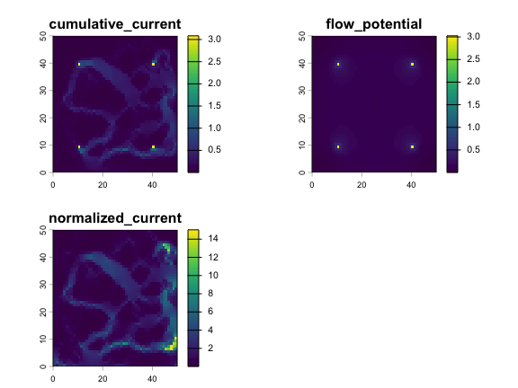
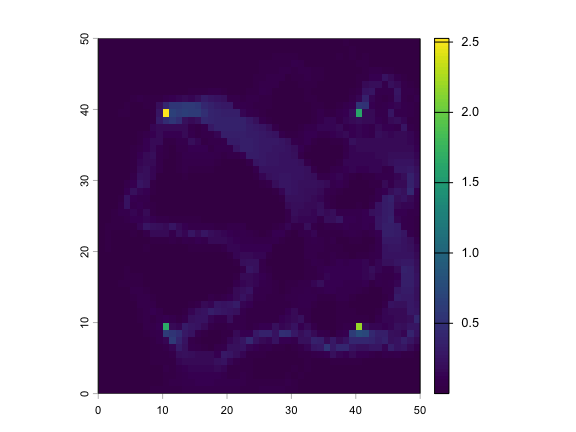
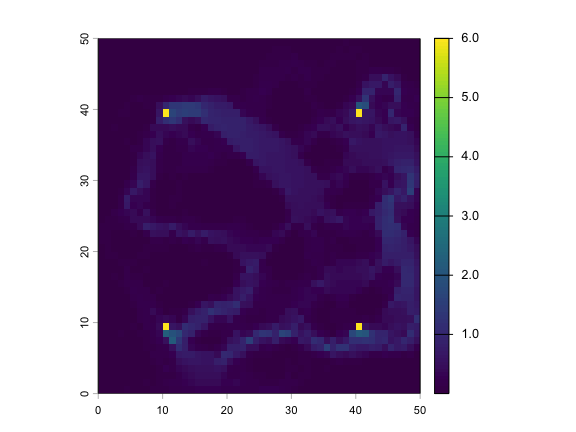
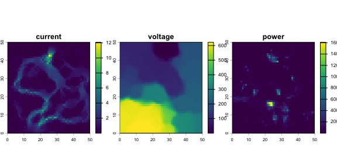
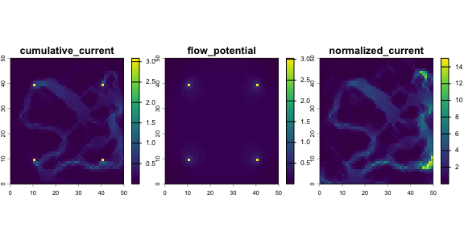
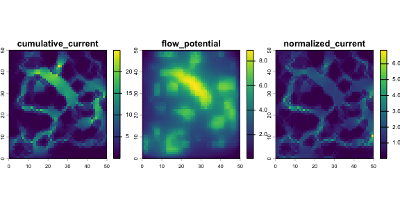

# Circuitscape and Omniscape

The `cs_*()` and `os_*()` functions run
[Circuitscape.jl](https://github.com/Circuitscape/Circuitscape.jl) and
[Omniscape.jl](https://github.com/Circuitscape/Omniscape.jl):
circuitscaper writes their configuration files from your R arguments and
rasters, runs them in Julia, and reads the results back as terra
rasters. This article covers each mode and its options; see
[`vignette("getting-started")`](https://matthewkling.github.io/circuitscaper/articles/getting-started.md)
for installation, inputs and choosing a method. For more on the methods
themselves, see the
[Circuitscape](https://docs.circuitscape.org/Circuitscape.jl/latest/)
and [Omniscape](https://docs.circuitscape.org/Omniscape.jl/latest/)
documentation.

## Circuitscape: pairwise mode

Pairwise mode solves a circuit for every pair of focal nodes, with one
unit of current flowing from one to the other.

``` r

library(terra)
library(circuitscaper)

# Resistance surface (higher values = harder to traverse)
resistance <- rast(system.file("extdata/resistance.tif", package = "circuitscaper"))

# Option 1: Focal nodes as coordinates (simplest)
coords <- matrix(c(10, 40, 40, 40, 10, 10, 40, 10), ncol = 2, byrow = TRUE)
result <- cs_pairwise(resistance, coords)

# Option 2: Focal nodes as a raster (integer IDs; 0 and NA are not nodes)
# locations <- rast("path/to/focal_nodes.tif")
# result <- cs_pairwise(resistance, locations)

# Cumulative current map -- high values indicate important movement corridors
plot(result$current_map)
```



plot of chunk pairwise

``` r


# Pairwise resistance matrix -- can be used as a connectivity distance metric
result$resistance_matrix
#>          1        2        3        4
#> 1  0.00000 22.80786 23.09078 17.39341
#> 2 22.80786  0.00000 37.00636 25.87992
#> 3 23.09078 37.00636  0.00000 24.98422
#> 4 17.39341 25.87992 24.98422  0.00000
```

## Circuitscape: one-to-all and all-to-one modes

One-to-all mode injects current at each focal node in turn, with all the
others grounded; all-to-one mode grounds each node in turn, with all the
others injecting.

``` r

result <- cs_one_to_all(resistance, coords)
plot(result)
```



plot of chunk one-to-all

``` r

result <- cs_all_to_one(resistance, coords)
plot(result$cumulative_current)
```



plot of chunk all-to-one

## Circuitscape: advanced mode

Advanced mode takes explicit source current and ground conductance
rasters and solves one circuit.

``` r

source_layer <- rast(system.file("extdata/source.tif", package = "circuitscaper"))
ground_layer <- rast(system.file("extdata/ground.tif", package = "circuitscaper"))

result <- cs_advanced(resistance, source_layer, ground_layer,
                      ground_is = "conductances")

# Current density -- corridors and pinch points where flow is concentrated,
# i.e. possible preservation priorities
# Voltage -- analogous to movement probability, decreasing with distance
# and resistance from sources
# Power dissipation -- areas of current flow through high-resistance areas,
# i.e. possible restoration priorities
power <- result[["current"]]^2 * resistance
plot(c(result[["current"]], result[["voltage"]], power), nc = 3,
     main = c("current", "voltage", "power"))
```



plot of chunk advanced

## Additional Circuitscape options

### Per-pair current and voltage maps

By default, pairwise, one-to-all, and all-to-one modes return only the
cumulative current map (for pairwise, with flow potential and normalized
current; see below). Set `cumulative_only = FALSE` to include per-pair
(or per-node) current layers, and `write_voltage = TRUE` to include
voltage layers:

``` r

result <- cs_pairwise(resistance, coords,
                      cumulative_only = FALSE,
                      write_voltage = TRUE)
names(result$current_map)
#>  [1] "cumulative_current" "flow_potential"     "normalized_current"
#>  [4] "current_1_2"        "current_1_3"        "current_1_4"       
#>  [7] "current_2_3"        "current_2_4"        "current_3_4"       
#> [10] "voltage_1_2"        "voltage_1_3"        "voltage_1_4"       
#> [13] "voltage_2_3"        "voltage_2_4"        "voltage_3_4"
```

### Variable source strengths

By default, each focal node injects 1 amp of current. Use
`source_strengths` to assign different injection strengths per node —
useful when sites differ in population size or habitat area:

``` r

# Strengths in the same order as the locations
strengths <- c(2.5, 1.0, 0.5, 1.0)
result <- cs_one_to_all(resistance, coords, source_strengths = strengths)
```

### Short-circuit regions

Short-circuit regions represent areas of zero resistance (e.g., lakes
that can be crossed freely, or developed areas that funnel movement).
Pass a raster where cells sharing the same positive integer value are
short-circuited:

``` r

polygons <- rast("path/to/short_circuit_regions.tif")
result <- cs_pairwise(resistance, coords, short_circuit = polygons)
```

### Include/exclude pairs

For large numbers of focal nodes, you may want to restrict analysis to a
subset of pairs:

``` r

result <- cs_pairwise(resistance, coords,
                      included_pairs = "path/to/pairs.txt")
```

### Normalized current

[`cs_pairwise()`](https://matthewkling.github.io/circuitscaper/reference/cs_pairwise.md)
and Omniscape return normalized current (current divided by flow
potential) by default. For
[`cs_pairwise()`](https://matthewkling.github.io/circuitscaper/reference/cs_pairwise.md),
flow potential is the same analysis on a uniform surface: resistance 1
on the same cells, with the same focal nodes. It shows the current
expected from the layout of the nodes alone:

``` r

result <- cs_pairwise(resistance, coords)
plot(result$current_map, nc = 3)
```



plot of chunk normalized

Values greater than 1 indicate areas where landscape resistance is
concentrating current flow; values less than 1 indicate areas where
current is lower than expected from geometry alone. Normalizing runs
Circuitscape twice, so set `normalize = FALSE` if you don’t need it.

For the other Circuitscape modes, you can compute the equivalent
yourself by running the analysis on a uniform surface and dividing:

``` r

result      <- cs_one_to_all(resistance, coords)
result_null <- cs_one_to_all(resistance * 0 + 1, coords)
normalized  <- result / result_null
```

## Omniscape: moving-window connectivity

Omniscape computes omnidirectional connectivity using a moving window.
It does not require focal nodes — every cell can serve as a source.

The two key parameters are:

- **`radius`**: The moving window radius in pixels. This defines the
  neighborhood over which connectivity is evaluated — conceptually, how
  far the organism can disperse. Larger radii capture longer-distance
  connectivity but increase computation time substantially.
- **`block_size`**: Aggregation factor for source points (default 1, no
  aggregation). Setting `block_size = 3` groups sources into 3x3 blocks,
  reducing the number of circuit solves with typically negligible
  effects on results. This is the primary knob for trading off speed
  vs. precision.

``` r

result <- os_run(resistance, radius = 20, block_size = 3)
```

Omniscape returns up to three layers:

- **`cumulative_current`**: Raw current flow summed across all
  moving-window iterations. Higher values indicate cells that carry more
  current overall.
- **`flow_potential`**: What current flow would look like if resistance
  were uniform everywhere. This isolates the effect of source geometry
  from landscape resistance.
- **`normalized_current`**: Cumulative current divided by flow
  potential. Values greater than 1 indicate corridors where connectivity
  is higher than expected given the arrangement of sources; values less
  than 1 indicate relative barriers. This is usually the most
  informative layer.

``` r

plot(result, nc = 3)
```



plot of chunk omniscape-plot

### With source strength weights

By default, source strength is derived from the inverse of resistance.
You can provide an explicit source strength raster (e.g., habitat
quality) to weight sources independently of resistance:

``` r

source_strength <- rast("path/to/habitat_quality.tif")

result <- os_run(resistance, radius = 20,
                 source_strength = source_strength)
```

### Conditional connectivity

Conditional connectivity restricts which sources are connected to each
target, based on their values on a condition layer. Use
[`os_condition()`](https://matthewkling.github.io/circuitscaper/reference/os_condition.md)
to define the comparison. For categorical data, `type = "equal"`
connects only cells in the same class:

``` r

landcover <- rast("path/to/landcover.tif")

result <- os_run(resistance, radius = 20,
                 condition = os_condition(landcover, type = "equal"))
```

For continuous data, `lower` and `upper` bound the difference between
source and target values. Supplying a `future` layer compares each
source’s present-day value against the target’s future value, as in
climate-tracking connectivity. Here, sources connect to targets whose
future temperature is between 1 degree cooler and 3 degrees warmer than
the source’s present temperature:

``` r

temp_now <- rast("path/to/temperature_current.tif")
temp_future <- rast("path/to/temperature_2080.tif")

result <- os_run(resistance, radius = 20,
                 condition = os_condition(temp_now, future = temp_future,
                                          lower = -3, upper = 1))
```

Up to two conditions can be combined by passing a list of
[`os_condition()`](https://matthewkling.github.io/circuitscaper/reference/os_condition.md)
objects; see
[`?os_condition`](https://matthewkling.github.io/circuitscaper/reference/os_condition.md)
for details.

### Parallel processing

For large landscapes, enable Julia multithreading to reduce compute
times. Set the number of threads with
[`cs_setup()`](https://matthewkling.github.io/circuitscaper/reference/cs_setup.md),
ideally at the start of your session:

``` r

cs_setup(threads = 4)

result <- os_run(resistance, radius = 20,
                 block_size = 5,
                 parallelize = TRUE)
```

Julia’s thread count is fixed when Julia starts, so if Julia is already
running with fewer threads, `cs_setup(threads = 4)` restarts it, and
Circuitscape and Omniscape are loaded and warmed up again on the next
`cs_*()` or `os_*()` call. If the running Julia session can’t run in
parallel,
[`os_run()`](https://matthewkling.github.io/circuitscaper/reference/os_run.md)
warns, says how to fix it, and runs serially.

## Performance

Circuitscape computation time scales with the number of non-NA cells in
the resistance raster and, for focal-node modes, with the number of
pairs or iterations. A few practical guidelines:

- **Raster size**: Problems up to ~1 million cells run comfortably. For
  larger landscapes, consider aggregating the resistance surface before
  analysis.
- **Number of focal nodes**: Pairwise mode solves n\*(n-1)/2 circuits,
  so computation grows quadratically with the number of nodes. Use
  `included_pairs` to limit the set if needed, or consider
  [`dp_pairwise()`](https://matthewkling.github.io/circuitscaper/reference/dp_pairwise.md),
  whose time hardly depends on the number of nodes.
- **Omniscape**: Computation is dominated by the number of source pixels
  and the `radius`. Use `block_size` to reduce the source count and keep
  `radius` as small as ecologically justified. Enable
  `parallelize = TRUE` for large runs, or consider
  [`dp_omni()`](https://matthewkling.github.io/circuitscaper/reference/dp_omni.md),
  whose time hardly depends on the radius.
- **Solver choice**: The default `"cg+amg"` (iterative) solver works
  well for large problems. For small rasters (under ~10,000 cells),
  `"cholmod"` (direct solver) may be faster.

## Saving outputs

By default, intermediate files are written to a temporary directory and
cleaned up. To persist output files (ASC rasters, INI configuration, and
resistance matrices), use `output_dir`:

``` r

result <- cs_pairwise(resistance, coords,
                      output_dir = "my_output_directory")
```

Set `verbose = TRUE` to see Circuitscape’s solver progress, useful for
debugging or monitoring long runs.
