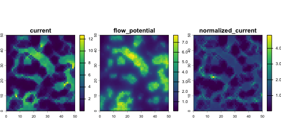
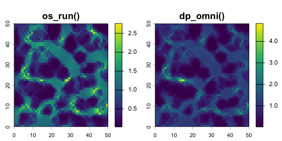
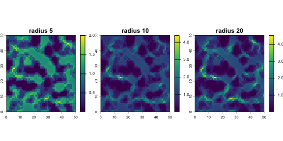
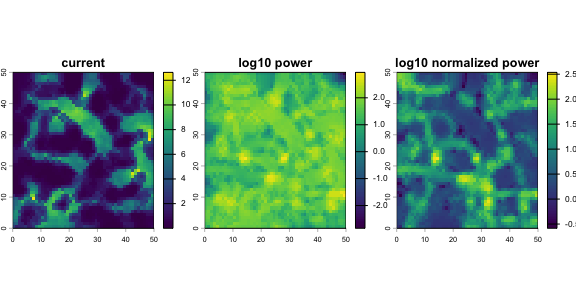
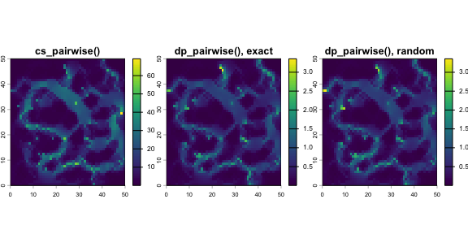
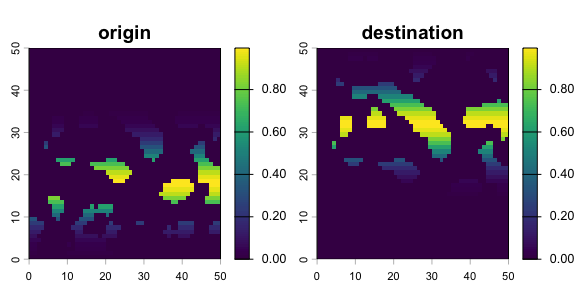
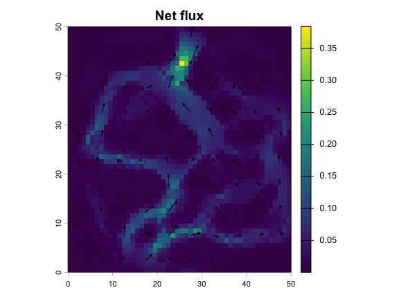
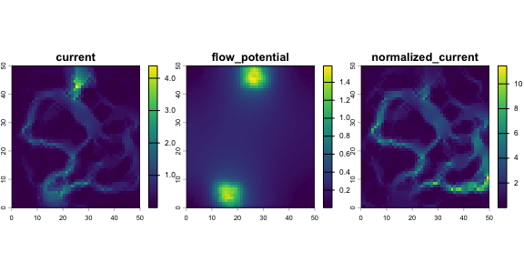
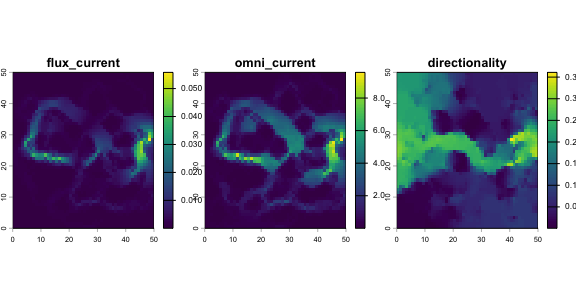

<!-- dipole-methods.Rmd is generated from dipole-methods.Rmd.orig, which
needs Julia: run dev/precompute-articles.R. Edit the .orig file. -->


The dipole methods are circuitscaper's own connectivity methods. They map
pairwise and omnidirectional connectivity, and connectivity between two
distributions, on the same circuits
Circuitscape builds, but instead of solving one circuit per pair, window or
source, they factor the circuit once and solve many balanced source–sink
pairs ("dipoles") against it at a time, combined by superposition. A map
takes one factorization and about 32 solves, whatever the number of pairs
it covers.

> **Status: experimental.** The dipole methods are new and not yet
> published. They are tested against exact answers (see
> [Validation](#validation)), but their interface may change, and their
> maps are of a related but different quantity from Circuitscape's and
> Omniscape's (see [How the results
> differ](#how-the-results-differ-from-circuitscape-and-omniscape)).

| Function | Maps | Closest established method |
|---|---|---|
| `dp_omni()` | Omnidirectional connectivity among habitat within a dispersal radius; with a `destination`, the routes linking two distributions | `os_run()` |
| `dp_pairwise()` | Connectivity among every pair of a set of focal nodes | `cs_pairwise()` (cumulative current) |
| `dp_flux()` | Net flow from an origin to a destination distribution, with direction | `cs_advanced()` with sources at the origin and grounds at the destination |
| `dp_circuit()` | A factored circuit, to reuse across runs | |

The first half of this article shows how to use them; the second explains
how they work. Installation and inputs are as for the rest of the package
(see `vignette("getting-started")`); the dipole methods run in the same
Julia session.

## Omnidirectional connectivity

`dp_omni()` plays Omniscape's role: connectivity among all habitat cells
within a dispersal `radius` of each other, with no focal nodes. Its
arguments mirror `os_run()`'s: a resistance surface, a radius in pixels,
and optionally a source-strength surface such as habitat suitability (by
default, conductance, as in `os_run()`).


``` r
library(terra)
library(circuitscaper)

resistance <- rast(system.file("extdata/resistance.tif", package = "circuitscaper"))

result <- dp_omni(resistance, radius = 10, seed = 1)
result
#> class       : SpatRaster
#> size        : 50, 50, 3  (nrow, ncol, nlyr)
#> resolution  : 1, 1  (x, y)
#> extent      : 0, 50, 0, 50  (xmin, xmax, ymin, ymax)
#> coord. ref. : lon/lat WGS 84 (CRS84) (OGC:CRS84)
#> source(s)   : memory
#> names       :   current, flow_potential, normalized_current
#> min values  :  0.001193,        0.06085,           0.018936
#> max values  : 12.640086,       7.724435,           4.832281
plot(result, nc = 3)
```



The three layers correspond to Omniscape's:

- **`current`**: how strongly connectivity among habitat within reach
  depends on each cell. Formally, it's the square root of a kernel-weighted
  sum over habitat pairs of the squared current each pair sends through the
  cell (see [What dp_omni() maps](#what-dp_omni-maps)). It is not Omniscape's
  cumulative current, though it ranks cells similarly.
- **`flow_potential`**: the same quantity on a circuit of uniform resistance,
  reflecting only where habitat is.
- **`normalized_current`**: current divided by flow potential: above 1 where
  the landscape channels flow, below 1 where it impedes it.

Here is the same analysis in Omniscape, with each method's normalized
current:


``` r
os <- os_run(resistance, radius = 10)

compare <- c(os$normalized_current, result$normalized_current)
names(compare) <- c("os_run()", "dp_omni()")
plot(compare, nc = 2)
```



``` r

# Spearman correlation between the methods' layers
rho <- function(a, b) {
  cor(values(a, mat = FALSE), values(b, mat = FALSE),
      method = "spearman", use = "complete.obs")
}
c(current = rho(os$cumulative_current, result$current),
  flow_potential = rho(os$flow_potential, result$flow_potential),
  normalized_current = rho(os$normalized_current, result$normalized_current))
#>            current     flow_potential normalized_current 
#>          0.9750985          0.9748595          0.9527434
```

The patterns match closely, but not exactly, because the two methods compute
different quantities. On a larger, real suitability surface (*Pinus edulis*
at 2 km, 0.73 million cells), current agreed at Spearman's
$\rho \approx$ 0.95–0.98 and normalized current at $\rho \approx$ 0.86,
falling a little as the radius grew.

## Reusing a circuit

Most of a run's time is building and factoring the circuit (two circuits
with `normalize = TRUE`: the resistance surface and the uniform one for flow
potential). The dipole solves themselves are cheap and hardly depend on the
radius. To run several analyses on one resistance surface — different radii,
source strengths, species, seeds or methods — build the circuit once with
`dp_circuit()` and pass it in place of the resistance surface:


``` r
circuit <- dp_circuit(resistance)
circuit
#> <dp_circuit> 2500 nodes, 9702 links, 1 connected component
#> grid: 50 x 50; with uniform circuit for flow potential

radii <- c(5, 10, 20)
sweep <- rast(lapply(radii, function(r) {
  dp_omni(circuit, radius = r, seed = 1)$normalized_current
}))
names(sweep) <- paste("radius", radii)
plot(sweep, nc = 3)
```



The factorization stays in the Julia session. If Julia restarts (for
instance, when `cs_setup()` raises the thread count), the circuit is rebuilt
the next time it is used.

## Power and choke points

Current shows where movement concentrates. Power, squared current times
resistance, shows where it is forced through resistance: choke points. Set
`power = TRUE` for a `power` layer, and with `normalize = TRUE`, a
`normalized_power` layer. Each link's power uses that link's resistance,
which depends on both cells it joins, so this is more accurate than
squaring a current map and multiplying by each cell's resistance,
especially where high- and low-resistance cells meet. It comes from the
same draws, so it costs no extra solves. Power spans orders of magnitude
where resistance does, so it is easiest to see on a log scale:


``` r
p <- dp_omni(circuit, radius = 10, seed = 1, power = TRUE)
plot(c(p$current, log10(p[[c("power", "normalized_power")]])), nc = 3,
     main = c("current", "log10 power", "log10 normalized power"))
```



## Accuracy and reproducibility

The maps are estimates with some sampling noise, which falls as
$1/\sqrt{\texttt{n\_draws}}$. Each result carries its own noise estimate in
the `"halves"` attribute: the map is computed separately from the odd and
the even draws, and the two half-estimates compared on source cells, by
Spearman correlation and by median relative difference. Each half has half
the draws, so its noise is $\sqrt{2}$ times the full map's, and the
difference between two halves is $\sqrt{2}$ times a half's: the full map's
typical relative error is about half the halves' median relative
difference.


``` r
attr(result, "halves")
#>                     spearman median_rel_diff
#> current            0.9772751       0.1313614
#> normalized_current 0.9383485       0.1041585
```

Two settings control accuracy:

- **`n_draws`** (default 32): the number of solves. This is the one to raise
  for a less noisy map: 4 times the draws halves the noise, at 4 times the
  solve time (though still only a small part of the total for one run).
- **`n_dipoles`** (default $10^5$): the number of dipoles per draw. Beyond
  enough to cover the habitat pairs well, more dipoles don't reduce the
  noise: a draw's noise is set by the random signs, not by how many dipoles
  it holds. Values don't depend on `n_dipoles` either, so runs with
  different settings are comparable.


``` r
draws <- c(8, 32, 128)
noise <- t(sapply(draws, function(n) {
  attr(dp_omni(circuit, radius = 10, n_draws = n, seed = 1), "halves")$median_rel_diff
}))
dimnames(noise) <- list(paste(draws, "draws"), c("current", "normalized_current"))
round(noise, 3)
#>           current normalized_current
#> 8 draws     0.236              0.190
#> 32 draws    0.131              0.104
#> 128 draws   0.055              0.045
```

On real landscapes at the default 32 draws, per-cell noise has been about
6–12% in current and 3–10% in normalized current. It is larger where
current is weak, in larger radii's normalized current, and on landscapes
where true connectivity varies little from cell to cell, since there's then
less signal to rank. Check the halves when you run a new landscape or
setting, and raise `n_draws` if they disagree more than you'd like.

Results are reproducible: they're determined by `seed`, the settings and
the circuit, and don't depend on the number of Julia threads (beyond the
last bits of floating-point rounding). If `seed` is `NULL`, one is drawn
from R's random number generator, so `set.seed()` works too; the seed used
is returned as the `"seed"` attribute. Random streams can change between
Julia versions.

## Focal nodes

`dp_pairwise()` maps connectivity among every pair of a set of focal nodes,
like `cs_pairwise()`'s cumulative current map. Pairwise Circuitscape solves
one circuit per pair, so its time grows with the square of the number of
nodes; `dp_pairwise()` solves 32 circuits whatever the number of nodes, each
one carrying every pair with a random weight. With `method = "exact"`, it
computes the exact answer instead from one solve per node.


``` r
set.seed(1)
nodes <- spatSample(resistance, 30, xy = TRUE, na.rm = TRUE)[, 1:2]

random <- dp_pairwise(circuit, nodes, seed = 1)
exact <- dp_pairwise(circuit, nodes, method = "exact")
cs <- cs_pairwise(resistance, nodes)

pw <- c(cs$current_map$cumulative_current, exact$current, random$current)
names(pw) <- c("cs_pairwise()", "dp_pairwise(), exact", "dp_pairwise(), random")
plot(pw, nc = 3)
```



``` r

c(random_vs_exact = rho(random$current, exact$current),
  exact_vs_circuitscape = rho(exact$current, cs$current_map$cumulative_current),
  normalized = rho(exact$normalized_current, cs$current_map$normalized_current))
#>       random_vs_exact exact_vs_circuitscape            normalized 
#>             0.9953820             0.9720331             0.9790386
```

As with `dp_omni()`, the quantity is squared rather than absolute current,
so `dp_pairwise()` ranks cells like `cs_pairwise()` (on the 2 km *P. edulis*
surface, $\rho$ = 0.98–0.997 for 25 to 200 nodes) without matching its
values. Both also return flow potential and normalized current, from the
same pairs on a uniform surface. `dp_pairwise()` doesn't give the
resistance matrix between nodes; use `cs_pairwise()` for that.

Focal nodes are given as for `cs_pairwise()`: a matrix of coordinates, or a
raster of positive integer IDs. Each node is one cell.

## Connectivity between two distributions

Some questions are about movement between two distributions rather than
within one: from present to future habitat under climate change, between
breeding and wintering ranges, between foraging and roosting habitat, or
from source populations to restoration sites. Two maps answer them, both
taking an origin and a destination surface:

- `dp_flux()` maps the **directional** flow from origin to destination:
  signed current, so flows in opposite directions cancel and the map shows
  net movement, with its direction (`flow_x`, `flow_y`). It takes a single
  solve and is exact.
- `dp_omni()` with a `destination` maps the **undirected** routes between
  them: squared current, so every pair counts whichever way it flows, and
  swapping origin and destination gives the same map. It uses random
  dipoles, as with one surface.

As an example, take the low-resistance cells of the example landscape as
habitat, and a range on it that shifts north: the same habitat, under a
climatic envelope centered 14 cells further north. The two distributions
overlap in the middle of the landscape, as present and future ranges, or
two seasonal ranges, often do:


``` r
habitat <- resistance == 1
y <- init(resistance, "y")
origin <- habitat * exp(-((y - 18) / 8)^2)
destination <- habitat * exp(-((y - 32) / 8)^2)
plot(c(origin, destination), nc = 2, main = c("origin", "destination"))
```



With no `radius` (the default), `dp_flux()` sends one unit of flow from the
origin to the destination, each cell in proportion to its strength,
wherever it has to go:


``` r
flux <- dp_flux(circuit, origin, destination)

plot(flux$current, main = "Net flow")
a <- aggregate(flux[[c("flow_x", "flow_y")]], 5, mean, na.rm = TRUE)
xy <- xyFromCell(a, seq_len(ncell(a)))
v <- values(a)
len <- sqrt(rowSums(v^2))
s <- 4 / max(len, na.rm = TRUE)
ok <- which(len * s > 0.2)   # skip arrows too short to draw
arrows(xy[ok, 1], xy[ok, 2], xy[ok, 1] + s * v[ok, 1], xy[ok, 2] + s * v[ok, 2],
       length = 0.04)
```



With a `radius`, only origin and destination cells within reach of each
other are paired, so each origin cell sends its flow to the destination
habitat near it. Three attributes say how much of the two distributions
the map covers. `"origin_in_reach"` and `"destination_in_reach"` are the
shares of origin and destination strength with any counterpart within
reach; origin cells without one send nothing. `"pair_weight_in_reach"` is
the share of all origin–destination pairs (weighted by strength) that are
within reach. It shrinks as the domain grows relative to the radius, even
where each origin cell has destination habitat nearby, so use the first
two to ask whether most of the origin can reach a destination:


``` r
near <- dp_flux(circuit, origin, destination, radius = 15)
unlist(attributes(near)[c("origin_in_reach", "destination_in_reach",
                          "pair_weight_in_reach")])
#>      origin_in_reach destination_in_reach pair_weight_in_reach 
#>             0.974758             1.000000             0.229299
```

`dp_omni()` with a `destination` maps the routes between the two
distributions within reach, with flow potential and normalized current as
for one surface:


``` r
between <- dp_omni(circuit, radius = 15, source_strength = origin,
                   destination = destination, seed = 1)
plot(between, nc = 3)
```



`dp_directionality()` computes both maps at once, from the same pairs, and
their ratio, `directionality`. It works like an $R^2$: the share of the
pairs' squared current (and so of the power they dissipate) that their mean
flow accounts for. It is near 1 where all pairs cross a cell the same way,
and near 0 where flows in opposite directions cancel, so it shows where
movement between the two distributions is one-way and where it runs both
ways. Here, movement is most one-way along the corridor between the two
ranges, and least where they overlap:


``` r
both <- dp_directionality(circuit, origin, destination, radius = 15,
                          normalize = FALSE, seed = 1)
plot(both[[c("flux_current", "omni_current", "directionality")]], nc = 3)
```



### Choosing a map

The dipole maps differ along four lines:

- **Directional or undirected.** Directional maps sum signed current, so
  opposite flows cancel; undirected maps sum squared current, so they don't.
- **One surface or two.** Pairs are drawn from one distribution, or from an
  origin to a destination.
- **Radius or unconstrained.** Pairs are limited to cells within `radius`,
  or not.
- **Distributed or focal.** Every cell of a surface takes part, in
  proportion to its strength, or only a set of focal nodes.

| | Undirected | Directional |
|---|---|---|
| One surface | `dp_omni()` | (always zero) |
| Two surfaces | `dp_omni(destination = )` | `dp_flux()` |
| Focal nodes | `dp_pairwise()` | |

A directional map from one surface is always zero: for every pair from
$i$ to $j$ there is the same pair from $j$ to $i$, and their currents
cancel. With two surfaces, `dp_directionality()` gives both columns at
once. The directional map is never more than the undirected one, once both
are on the same scale, which is what makes its ratio a share between 0
and 1. `dp_omni()`,
`dp_flux()` and `dp_directionality()` all take a `radius` (in `dp_flux()`
and `dp_directionality()`, the default is no limit); `dp_pairwise()` pairs
all focal nodes.

## Radius units

By default `radius` counts cells, as in `os_run()`. With
`radius_units = "km"` it is a distance in kilometres: great-circle distance
between cell centres on longitude/latitude grids, where the kernel narrows
in degrees of longitude towards the poles, or distance in the coordinate
system's units on projected grids.


``` r
suitability <- rast("path/to/suitability.tif")   # e.g. lon/lat, 2 km cells
result <- dp_omni(resistance, radius = 50, radius_units = "km",
                  source_strength = suitability)
```

## Performance and memory

The time is mostly one or two sparse factorizations (Cholesky, through
Julia's SuiteSparse) and the solves, both parallel over Julia's threads; set
the number with `cs_setup(threads = )`. It barely depends on the radius or
the number of focal nodes. Timings on a 10-core MacBook Pro with 68 GB of
memory, 10 threads, `dp_omni()` with `normalize = TRUE` at the default 32
draws of $10^5$ dipoles, on synthetic suitability surfaces:

| Cells | `dp_circuit()` | `dp_omni()` with the circuit | Peak memory (Julia) |
|---|---|---|---|
| 0.73 million | 3 s | 4 s | 4 GB |
| 7 million | 45 s | 34 s | 29 GB |
| 18 million | 3.0 min | 2.2 min | 40–45 GB |

A first `dp_omni()` call on a raster includes building the circuit, so it
takes about the sum of the two columns. Starting Julia adds a few seconds once per session; the dipole methods
don't need the Circuitscape and Omniscape packages, so a session that
only uses them skips loading and warming those up.

For comparison, on the 0.73-million-cell *P. edulis* surface on the same
machine, `os_run()` on 10 threads took 48–116 s for radii of 15–120 cells
(with block sizes of 1–11 chosen for each radius), and `cs_pairwise()` took
13 minutes for 200 focal nodes on one thread, where `dp_pairwise()` takes a
few seconds for any number of nodes. These are one landscape's benchmarks;
Omniscape's and Circuitscape's iterative solvers are sensitive to the
resistance surface, so speedups will vary.

Memory is the main limit at scale. It is mostly the factorizations, which
grow faster than the number of cells: each holds about 1.8 billion nonzeros
(14 GB) at 18 million cells, and peak memory during factoring is higher
still. Grids too large to factor whole will need tiling, which isn't
implemented yet.

## How the methods work

### The circuit

`dp_circuit()` builds Circuitscape's default raster circuit: each non-NA
cell is a node, joined to its 8 neighbours by links of conductance
$(c_u + c_v)/2$, divided by $\sqrt{2}$ on diagonals, for cell conductances
$c$. A link is the resistor between two neighbouring cells. Current flows
along links, so the maps are defined per link and then combined over the
links that meet at each cell (up to 8), each link being shared by the two
cells it joins. With node voltages $v$ and a vector $b$ of currents injected at the
nodes, the circuit's equations are $L v = b$, where $L$ is the graph
Laplacian. A tiny conductance to ground at every node ($10^{-12}$) makes
$L$ positive definite. It carries essentially no current, because every
injection here is balanced: as much current leaves the circuit as enters.

$L$ is the same whatever is injected, so it is factored once (a sparse
Cholesky factorization), after which each new $b$ costs only a cheap pair of
triangular solves, and many injections can be solved at once. That is the
whole trick behind the dipole methods: build injections that answer the
question in a few solves.

Groups of cells separated by NA cells form separate circuits (components).
No current passes between them, so no pair spans two components.

### What dp_omni() maps

For a pair of cells $i$ and $j$, let $I_e(i,j)$ be the current through link
$e$ when one unit of current enters at $i$ and leaves at $j$. `dp_omni()`
estimates, for every link,

$$
T_e = \sum_{i \ne j} w_i\, w_j\, k(d_{ij})\, I_e(i,j)^2,
$$

a sum over (ordered) pairs of cells, where $w$ is source strength and $k$
is the dispersal kernel: 1 for cells within `radius` of each other and 0
otherwise. A cell's `current` is $\sqrt{\tfrac{1}{2}\sum_{e} T_e}$ over the
links $e$ that meet at the cell.

Squared current has a direct meaning. For a unit flow between $i$ and $j$,
the squared current through a link equals the derivative of the pair's
effective resistance with respect to the link's resistance, a consequence
of Thomson's principle. So $T_e$ measures how much the habitat-weighted,
dispersal-limited sum of pairwise effective resistances would rise if link
$e$ got harder to cross: how much connectivity among habitat within reach
depends on that link.

### Random dipoles

Computing $T_e$ directly would need a solve for every pair of habitat
cells. Instead, each draw builds one injection from $M$ dipoles
(`n_dipoles`): pairs $(i_d, j_d)$ drawn with probability proportional to
$w_i w_j k(d_{ij})$, each with a random sign $s_d = \pm 1$,

$$
b = \sum_{d=1}^{M} s_d \,(\mathbf{e}_{i_d} - \mathbf{e}_{j_d}),
$$

where $\mathbf{e}_i$ is one unit at cell $i$. By superposition, the current
this injection drives through link $e$ is the signed sum of the dipoles'
currents, $I_e(b) = \sum_d s_d\, I_e(i_d, j_d)$. Squaring it gives the sum
of each dipole's squared current plus cross terms $s_d s_{d'} I_e(i_d, j_d)
I_e(i_{d'}, j_{d'})$ between dipoles. The signs are independent, so every
cross term averages to zero, and

$$
\mathbb{E}\big[I_e(b)^2\big] = M\, \mathbb{E}_{(i,j)}\big[I_e(i,j)^2\big] = \frac{M}{S}\, T_e,
$$

with $S = \sum_{i \ne j} w_i w_j k(d_{ij})$ the total pair weight, computed
exactly. So $\frac{S}{M}$ times the mean of $I_e(b)^2$ over draws estimates
$T_e$ without bias, from one solve per draw.

The noise of one draw is set by the random signs. With many dipoles,
$I_e(b)$ is close to normally distributed, so its square is the target
times a $\chi^2_1$ variable, with a relative standard deviation of
$\sqrt{2} \approx 1.4$ however many dipoles there are. Averaging 32 draws
cuts that to 25% on the squared scale, about 12% on the square-root scale of
the maps, and less again where a cell's links add independent noise. More
dipoles only help to cover the population of pairs well, which happens by
around $10^5$.

Pairs are sampled exactly, in two stages: the first cell $i$ in proportion
to $w_i$ times the weight of the other cells within its reach, then the
second among those cells in proportion to $w_j$, by picking a row of the
kernel from per-row prefix sums of $w$ and a column by binary search. Each
dipole costs one step per kernel row, however sparse the habitat. $S$ sums
over exactly the pairs the sampler can produce, within each component.

### Flow potential and normalization

`flow_potential` is the same estimate on the uniform circuit (conductance 1
on the same cells), with the same dipoles, and `normalized_current` is
current divided by flow potential. Reusing the dipoles cancels much of the
sampling noise in the ratio, which is why normalized current is less noisy
than current.

With `power = TRUE`, a link's power is its summed squared current times its
resistance, $1/g_e$, and a cell's `power` is half the sum over its links,
so the cells sum to the circuit's total. `normalized_power` divides it by
the power on the uniform circuit, whose links have resistance 1 (or
$\sqrt{2}$ on diagonals). It therefore has the units of resistance, unlike
normalized current, and is best compared within a surface.

### Focal nodes

For $N$ focal nodes, `dp_pairwise()` targets
$\sum_{i<j} I_e(i,j)^2$ over every pair. With `method = "random"`, each draw
injects every pair at once, weighted by independent standard normal
variables $\xi_{ij}$:

$$
b = \sum_{i<j} \xi_{ij}\, (\mathbf{e}_i - \mathbf{e}_j),
\qquad
\mathbb{E}\big[I_e(b)^2\big] = \sum_{i<j} I_e(i,j)^2,
$$

for the same reason as above. No pair sampling is needed, and the cost is
one solve per draw for any $N$.

With `method = "exact"`, it takes one solve per node. If $y_i$ is the
current through a link when node $i$ is the source (against a common
reference), the pair $(i, j)$ drives $y_i - y_j$, and

$$
\sum_{i<j} (y_i - y_j)^2 = N \sum_i y_i^2 - \Big(\sum_i y_i\Big)^2 ,
$$

so the all-pairs sum needs only the $N$ solves.

### Two-distribution methods

Both maps sum over pairs of an origin cell $i$ and a destination cell $j$
with weights $o_i\, d_j\, k(d_{ij})$, where $o$ and $d$ are origin and
destination strength and $k$ is 1 within the radius (or everywhere, with no
radius) and 0 otherwise, in the same component.

`dp_omni()` with a `destination` sums the pairs' squared currents
$I_e(i,j)^2$, as with one surface but with these weights. The pairing is
one-way, but a pair's squared current is the same in both directions, so
random signs still apply, and the map doesn't depend on which surface is
the origin. Cells in both distributions take part at both ends. Its
dipoles are centered on their mean (see below).

`dp_flux()` sums the pairs' signed currents $I_e(i,j)$, divided by the
total weight $W = \sum_{i,j} o_i\, d_j\, k(d_{ij})$ so that one unit flows
in all. The sum is linear in the currents, so it is the current from a
single injection,

$$
b_i = \frac{o_i\, (Kd)_i - d_i\, (Ko)_i}{W} ,
$$

where $(Kd)_i$ is the destination strength within reach of cell $i$ and
$(Ko)_i$ the origin strength within reach of it: each origin cell sends in
proportion to its strength and the destination within its reach, and each
destination cell receives in proportion to its strength and the origin
within its reach. The kernel sums take prefix sums along the rows of the
grid, as for $S$. With no radius and one component, this is
$b = o / \sum o - d / \sum d$, the minimum-energy flow that turns the
origin distribution into the destination one. The withdrawals are fixed
amounts, not grounds: each destination cell takes its share however far
away it is, whereas with grounds, as in `cs_advanced()`, current drains
into whichever destination is electrically nearest. Where the two
distributions overlap, a cell's pair with itself counts in $W$ but moves
nothing, so flow cancels there and the map mostly shows movement from
origin-only to destination-only habitat. With several components, each
carries its share of $W$; origin cells with no destination within reach
send nothing. $W / (\sum o \sum d)$ is returned as `"pair_weight_in_reach"`,
and the shares of $o$ on cells with $(Kd)_i > 0$ and of $d$ on cells with
$(Ko)_j > 0$ as `"origin_in_reach"` and `"destination_in_reach"`.
`dp_flux()`'s flow potential is the same injection solved on the uniform
circuit.

`dp_directionality()` compares the two. On each link, $F_e$ is the pairs'
weighted mean current and $U_e / W$ their weighted mean squared current, so

$$
R_e = \frac{W F_e^2}{U_e} = 1 - \frac{\mathrm{Var}(I_e)}{\mathrm{E}[I_e^2]}
$$

is between 0 and 1: the share of the pairs' squared current that their
mean flow accounts for. A cell's `directionality` is
$W \sum_e F_e^2 / \sum_e U_e$ over the links that meet at it, the links'
$R_e$ averaged with weights $U_e$. Only squares work here: the directional
map gives the pairs' mean current exactly and the random dipoles give their
mean square, but no superposition gives their mean absolute current, which
an $L_1$ version of the ratio would need.

With two surfaces, the random dipoles are **centered**. The pairs' mean
dipole is $\bar b = (W / S)\, b$, with $b$ the flux injection above, and
its current is solved exactly. Each draw injects
$\sum_d s_d\, (\mathbf{e}_{i_d} - \mathbf{e}_{j_d} - \bar b)$, which
costs nothing extra, so its squared current estimates the variance of the
pairs' currents, $\mathbb{E}[I_e^2] - \bar I_e^2$; the exact
$\bar I_e^2$ is added back. This is still unbiased, but its noise is
proportional to the variance rather than to $\mathbb{E}[I_e^2]$, so it
shrinks by a factor of about $1 - R$. That matters most exactly where the
ratio is most interesting: where flow is one-way, the dipoles' currents
point the same way, so without centering every draw's noise there is one
shared random factor, and the ratio would be off by the same amount
(about $1.4 / \sqrt{\mathrm{n\_draws}}$) across the whole region. With
centering, the ratio also can't exceed 1. With one surface, the mean
dipole is zero and nothing changes.

### How the results differ from Circuitscape and Omniscape

The dipole methods compute well-defined quantities, but not the same ones
as Circuitscape and Omniscape:

- **Squared, not absolute, current.** Circuitscape and Omniscape add up the
  absolute current of each pair or window. Squared current weights strong,
  convergent flow more heavily, and it is what superposition with random
  signs can estimate cheaply. (Absolute current can be estimated with
  Cauchy-distributed weights in place of random signs, at about 10 times the
  draws; this isn't implemented yet.)
- **The whole circuit, not windows.** Omniscape solves each target's
  circuit inside a window of the given radius around it, clipped to that
  window. `dp_omni()`'s radius limits which pairs count, but each pair's
  current flows on the whole landscape, so a pair's current isn't truncated
  at the window's edge. Its flow potential, too, uses the landscape's own
  shape rather than a square box per target.
- **Pairs, not targets.** Omniscape gives each target its own strength's
  worth of current, shared among the sources in its window; `dp_omni()`
  weights each pair by the product of its two cells' strengths.
- **No injection term.** Circuitscape's cell maps add the current injected
  or withdrawn at a cell to that cell's value; the dipole maps count only
  current through a cell's links.

For pairwise analyses only the first point applies, so `dp_pairwise()`
agrees with `cs_pairwise()` more closely than `dp_omni()` does with
`os_run()`.

### Validation

The implementation is tested against exact answers:

- On small grids with patchy conductance, barriers, NA holes and more than
  one component, the target is computed exactly from a dense solve for
  every pair, and the estimates from many independent runs converge to it
  per cell, with no detectable bias.
- On a 64 $\times$ 64 crop of the *P. edulis* surface, `dp_omni()` converges
  to the exact current and flow potential.
- `dp_pairwise(method = "exact")` matches a brute-force sum over pairs, and
  the random method converges to it.
- The circuit, injections and per-link sums reproduce an independent R
  implementation to within $10^{-9}$.

## Limitations

- **A different quantity.** The maps rank cells like Circuitscape's and
  Omniscape's, but they are squared current on the whole circuit, so values
  aren't comparable with those tools' outputs or with published thresholds
  based on them.
- **Sampling noise.** Every map has some, reported in the `"halves"`
  attribute; halving it costs 4 times the draws.
- **No direction** from the random-dipole maps (`dp_omni()`,
  `dp_pairwise()`). `dp_flux()` gives direction.
- **Memory.** A factorization of the whole grid must fit in memory; see
  [Performance and memory](#performance-and-memory).
- **Limited testing on real landscapes.** The comparisons with Circuitscape
  and Omniscape quoted here are on one smoothed suitability surface. Sharp
  land-cover barriers haven't yet been compared.
- **Fewer options.** There are no short-circuit regions, conditional
  connectivity, voltage maps, per-pair maps or resistance matrices, and
  the kernel is a hard disk.

## Related work

Random-sign probes, and a few Laplacian solves in place of many exact
ones, are established in numerical linear algebra and network science: the
estimator here is a Hutchinson-type estimator (Hutchinson 1989), in the
family of random-projection estimators for effective resistance (Spielman &
Srivastava 2011). The derivative of effective resistance as squared current
follows from Thomson's principle (e.g. Christiano et al. 2011); with uniform
weights over all pairs, $T_e$ is the edge gradient of the Kirchhoff index
(Ghosh, Boyd & Saberi 2008), proposed as an edge centrality and estimated
with random projections by Li & Zhang (2018). The exact focal-node identity
is related to Brandes & Fleischer's (2005) algorithm for current-flow
betweenness. What the dipole methods add is the application to landscape
connectivity: habitat-weighted, dispersal-limited pair distributions on
raster circuits, flow-potential normalization, and the maps between two
distributions.

## References

- Brandes, U. & Fleischer, D. (2005). Centrality measures based on current
  flow. *STACS 2005*, Lecture Notes in Computer Science 3404, 533–544.
- Christiano, P., Kelner, J. A., Mądry, A., Spielman, D. A. & Teng, S.-H.
  (2011). Electrical flows, Laplacian systems, and faster approximation of
  maximum flow in undirected graphs. *STOC 2011*.
  [arXiv:1010.2921](https://arxiv.org/abs/1010.2921)
- Ghosh, A., Boyd, S. & Saberi, A. (2008). Minimizing effective resistance
  of a graph. *SIAM Review*, 50(1), 37–66.
- Hutchinson, M. F. (1989). A stochastic estimator of the trace of the
  influence matrix for Laplacian smoothing splines. *Communications in
  Statistics – Simulation and Computation*, 18(3), 1059–1076.
- Landau, V. A., Shah, V. B., Anantharaman, R. & Hall, K. R. (2021).
  Omniscape.jl: Software to compute omnidirectional landscape connectivity.
  *Journal of Open Source Software*, 6(57), 2829.
  [doi:10.21105/joss.02829](https://doi.org/10.21105/joss.02829)
- Li, H. & Zhang, Z. (2018). Kirchhoff index as a measure of edge
  centrality in weighted networks: nearly linear time algorithms. *SODA
  2018*. [arXiv:1708.05959](https://arxiv.org/abs/1708.05959)
- McRae, B. H. (2006). Isolation by resistance. *Evolution*, 60(8),
  1551–1561.
  [doi:10.1111/j.0014-3820.2006.tb00500.x](https://doi.org/10.1111/j.0014-3820.2006.tb00500.x)
- McRae, B. H., Dickson, B. G., Keitt, T. H. & Shah, V. B. (2008). Using
  circuit theory to model connectivity in ecology, evolution, and
  conservation. *Ecology*, 89(10), 2712–2724.
- Spielman, D. A. & Srivastava, N. (2011). Graph sparsification by
  effective resistances. *SIAM Journal on Computing*, 40(6), 1913–1926.
